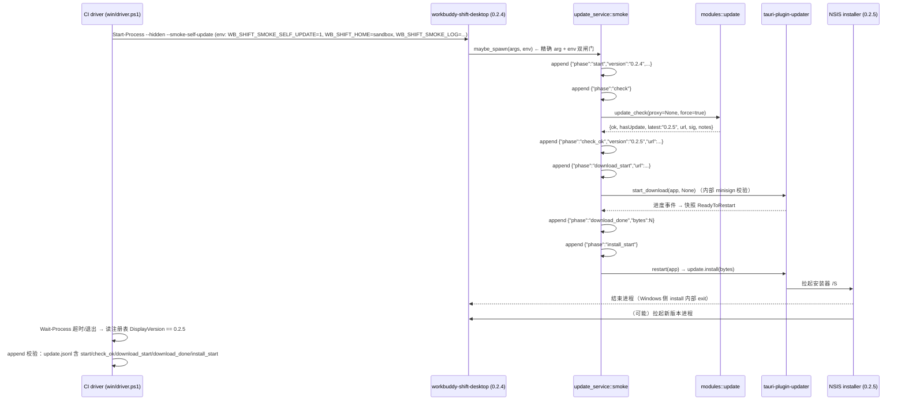
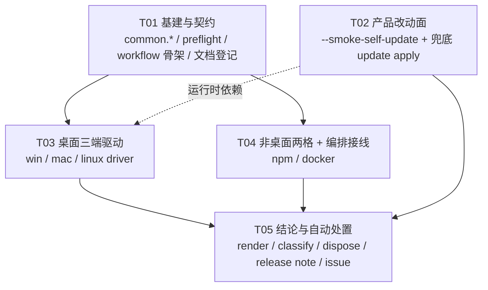

# 设计：发版后验收（Release Smoke）CI 子系统

> 架构师：高见远 · 版本锚点 v0.2.5 / v0.2.4 · 对应 PRD `delivery/prd-release-smoke.md`
> 本文覆盖 PRD 原文的两处不可实现/不可接受点（见 §0.2、§0.3），其余按 PRD 执行。

---

## 0. 摘要与本轮裁决

### 0.1 一句话架构

`release: published` 触发一条独立 workflow（不动 `build.yml`、不动 `test.yml`），**1 个预检 job + 5 个并行验收 job + 1 个汇总处置 job**；每个验收 job 由一个「驱动脚本」跑完并把结果写成同构 JSON，再由汇总 job 渲染成一张矩阵、写回 Release 正文（带标记区块，幂等）、对可自动修复的类别做**次数受限的一次性处置**。桌面端为满足「真跑升级」新增一个**隐藏、双重闸门的自更新触发参数** `--smoke-self-update`，默认路径零行为变化。

### 0.2 裁决一：Windows P0 用真·应用内升级（否决 PRD Q1 的 `overwrite-install`）

PRD Q1 的默认取值（`0.2.4 装 → 0.2.5 NSIS /S 覆盖`）在语义上不是「应用内升级」，用户已明确要求真跑。因此本期**新增产品参数** `--smoke-self-update`：启动后在后台走真实的 `update_service` 链路（`check` → `start_download` → `restart` → `update.install(bytes)`），把过程写成 JSON Lines 供 CI 断言。结论标 `upgrade_mode=in-app`。

兜底（仅当桌面 App 在托管 runner 上确实无法启动时启用）：在 `wb-shift-server` 加 `update apply` 子命令，复用 `wb_shift_core::modules::update::update_check` + minisign 校验，标 `upgrade_mode=cli-update`。**不退回覆盖安装**。

### 0.3 裁决二：GitHub Release 没有评论功能 → 改为正文标记区块 + issue

结论写回实现为：

1. Release 正文末尾维护 `<!-- release-smoke:begin -->` … `<!-- release-smoke:end -->` 区块，`gh release edit --notes-file` 幂等替换（保留原正文，先剥离旧区块再追加）；
2. 失败同时开/更新 issue（label `release-smoke`，同 tag 只一个，已存在则追加评论）。

### 0.4 升级口径词表（写死，结论里必须出现）

| `upgrade_mode` | 含义 | 适用 |
|---|---|---|
| `in-app` | 应用内更新链路：check → download → minisign 校验 → `update.install` → 进程退出/重启 | Windows（本期 P0） |
| `pkg-upgrade` | 用**该形态用户的真实升级途径**升级：dmg 覆盖 / `dpkg -i` 升级 / `npm i -g` 升级 | macOS、Linux deb、npm |
| `appimage-replace` | 同路径替换 AppImage 且 sha256 == Release 资产 sha256 | Linux AppImage |
| `cli-update` | 兜底：`wb-shift-server update apply`（复用 update_check + minisign） | 仅 Windows 兜底时 |
| ~~`overwrite-install`~~ | **禁用**。出现即视为流水线缺陷，判定为 FAIL | — |

---

## 1. 目标与非目标

### 1.1 目标

- **G1 可回答**：一次发布后 ≤25 分钟，Release 正文出现「形态 × 动作」矩阵，每格 ∈ {✅ 通过, ❌ 失败, ⏭ 不适用, ⛔ 无法判定}，每格可点到 artifact / 日志。
- **G2 真实性**：升级必须由**版本号变化**作证；启动必须有**进程存活 + 单实例退出 + 落盘 + 日志无 crash** 四元证据。
- **G3 不阻断 · 可审计**：与发版流程完全解耦（独立 workflow 文件、独立 run id），失败不改 Release 发布状态、不改源码、不改 tag；处置动作白名单 + 次数闸门 + 幂等。

### 1.2 非目标（明确不做，避免复杂度）

1. **不做 GUI 自动化**：无截图、无点击、无窗口/托盘/Dock 断言（PRD §4.1 已列为「不作为验收项」）。
2. **不做多发行版/多 Windows 版本/多架构矩阵**：只用托管 runner 默认镜像；macOS 只跑 `macos-latest`（arm64）。
3. **PR 阶段不跑**：本 workflow 无 `pull_request` 触发器，`test.yml` 保持不变。
4. 不做产物重签名、不改 `build.yml`/`docker.yml` 的既有行为（只被 **dispatch/rerun** 调用）。
5. 不做「自动修复代码 / 自动回滚 / 改版本号」（PRD §5 硬约束）。

---

## 2. 架构总览

### 2.1 组成

```
┌──────────────────────────── .github/workflows/release-smoke.yml ─────────────────────────┐
│  on: release[published] (+ workflow_dispatch{tag, force})                                │
│  concurrency: release-smoke-<tag> · cancel-in-progress: true                             │
│                                                                                          │
│   preflight(ubuntu)            ← 版本一致性 + 资产清单 + prev_tag + 平台适用性            │
│      ├── desktop-windows(windows-latest)                                                 │
│      ├── desktop-macos(macos-latest)                    ← 5 个并行，互不阻塞              │
│      ├── desktop-linux(ubuntu-latest)                                                    │
│      ├── npm-cli(ubuntu-latest)                                                          │
│      └── container-docker(ubuntu-latest)                                                 │
│              └── triage(ubuntu) if: always()  ← 归类 → 处置(≤3) → 结论写回 → issue        │
└──────────────────────────────────────────────────────────────────────────────────────────┘
        │ 每个验收 job：驱动脚本 → scripts/smoke/<form>/driver.*
        │                → artifacts/release-smoke/<form>.json （同构结果契约）
        ▼
   scripts/smoke/render-conclusion.py → conclusion.md（矩阵 + 链接）
   scripts/smoke/dispose.py           → gh run rerun / gh workflow run / gh issue
   scripts/smoke/update-release-note.sh → gh release edit --notes-file（标记区块幂等替换）
```

### 2.2 为什么是「驱动脚本 + 结果 JSON + gate 步骤」而不是「一个断言一个 step」

单格失败不能让后续格不出结果——否则矩阵永远缺格。因此：

- 每个验收 job = 1 个 `run: bash|pwsh driver` 步骤（**永远 exit 0**）+ 1 个 `Gate` 步骤（读 JSON，任一非 pass → exit 1）；
- artifact 上传用 `if: always()`，`triage` 用 `if: always()` 拉全部 artifact；
- gate 失败只影响「该 job 结论」，不影响其它 job（无 `needs` 串联），也不影响 Release 状态（不在 `build.yml` 里）。

### 2.3 状态机（Windows in-app 路径，最关键的一条）



对应「默认零影响」的判定点在 `maybe_spawn` 的第一行（详见 §3.2）。

---

## 3. 产品改动面（关键）

### 3.1 首选方案：`--smoke-self-update`

#### 3.1.1 落点

| 项 | 值 |
|---|---|
| 新增文件 | `src-tauri/src/update_service/smoke.rs`（≈230 行）+ `src-tauri/src/update_service/smoke/tests.rs`（≈130 行） |
| 改动文件 | `src-tauri/src/update_service/mod.rs`（`mod smoke; pub use smoke::*;` 2 行）、`src-tauri/src/lib.rs`（`setup()` 内 1 处 4 行调用） |
| 复用 | `update_service::check()`、`update_service::start_download()`、`update_service::restart()`、`update_service::snapshot()`、`create`/`UpdatePhase` 快照；`wb_shift_core::modules::update::{APP_VERSION, load_github_config}`；`wb_shift_core::modules::config::store_dir` |
| 不新建 | 不新增 Tauri command、不新增 IPC、不新增前端代码、不新增 capability/权限 |

关键实现约束：

- **必须在 `setup()` 之后、事件循环启动前 spawn**（`tauri::async_runtime::spawn`），且在 `tray::setup_startup_visibility` **之后**——不能打断正常启动时序；
- 走 `spawn_blocking`/async 的组合：`check` + `start_download` 是 async/立即返回，安装由 `restart()` 内部完成（其内部已把 `update.install` 放 `spawn_blocking`）；
- 下载完成判定：轮询 `snapshot().phase == ReadyToRestart`（间隔 500ms，上限 10 分钟），期间每 5s 追加一条 `download_progress`（`percent`）；
- 失败不 panic、不弹窗：所有错误只写日志 + 以退出码收尾（Rust 生产代码禁 `unwrap/expect`）。

#### 3.1.2 触发闸门（防普通用户误触）

三条同时满足才生效，任一不满足即**在产生任何副作用之前 return**：

1. **精确参数**：`std::env::args()` 中存在整参相等 `--smoke-self-update`（**禁止子串匹配**，与既有 `tray::is_silent_startup` 同款实现口径，避免 `--smoke-self-update-x` 误入）；
2. **二次确认环境变量**：`WB_SHIFT_SMOKE_SELF_UPDATE == "1"`；
3. **非演示模式**：`!crate::is_screenshot_demo()`（沿用 `WB_SHIFT_SCREENSHOT_DEMO` 的既有语义）。

其它防误触措施：

- **不进任何 help / usage / 用户文档**：桌面端本就没有 `--help`；不写进 `README.md` / `docs/cli.md` / `FAQ.md`；只在 `docs/ARCHITECTURE.md` 的「CI」小节记录（内部运维文档）；
- **与 `--hidden` 正交**：不改变 `--hidden` 语义；`--smoke-self-update` 单独出现时会话仍按普通启动（会显示窗口），CI 显式传 `--hidden --smoke-self-update`；
- **不注册到 autostart 参数**：`tauri_plugin_autostart` 的 `Some(vec![tray::SILENT_STARTUP_ARG])` 保持不变；
- **不写持久化状态**：不读写 `github_config.json` 的任何开关，不落「已升级」标记；唯一的落盘是追加式日志文件；
- 单实例：仍由 `tauri_plugin_single_instance` 最先注册，第二个 `--smoke-self-update` 进程会在建窗口前退出（对 CI 是「已有实例」的额外证据，不作主判据）。

#### 3.1.3 日志契约（CI 断言的对象）

路径优先级：`WB_SHIFT_SMOKE_LOG`（绝对路径，CI 指定）→ 否则 `<store_dir>/smoke-self-update.jsonl`。
格式：**JSON Lines，一行一个对象**，字段固定：

| 字段 | 类型 | 说明 |
|---|---|---|
| `ts` | string (ISO 8601 UTC) | 事件时刻 |
| `seq` | int | 从 0 单调递增，便于排序/去重 |
| `phase` | string | 见下表（**固定词表**，CI 按词表断言，不做模糊匹配） |
| `version` | string \| null | 目标版本（无 `v` 前缀） |
| `currentVersion` | string | 本进程版本（`APP_VERSION`） |
| `url` | string \| null | 下载地址 |
| `error` | string \| null | 失败原因（仅失败事件非 null） |
| `detail` | object \| null | 附加：`{bytes, percent, installerExit, logPath}` |
| `pid` | int | 进程号（跨重启区分进程） |

`phase` 词表：

```
start · check · check_ok · up_to_date · download_start · download_progress
download_done · install_start · install_ok · relaunch · done
error · abort
```

`abort` 只在闸门不满足/前置条件缺失时写（正常情况下不会被触发，因为此时连日志都不写；`abort` 用于「闸门满足但环境不可用」，如 `WB_SHIFT_SMOKE_LOG` 不可写）。

#### 3.1.4 退出码约定

| 退出码 | 含义 | CI 处理 |
|---|---|---|
| `0` | 流程走完且已执行安装（Windows 常被安装器提前接管，实际可能观察不到 0） | 继续断言版本 |
| `10` | 已是最新版本（无更新可下载） | 判 **H**（版本不一致：0.2.4 竟然认为自己是 latest） |
| `11` | 检查更新失败 | 由 `classify.py` 看 `error` 文本归 A（网络）或 G/J |
| `12` | 下载失败 / minisign 校验失败 | G（签名）或 A（网络） |
| `13` | 安装失败 | E |
| `14` | 环境不可用（日志不可写，例如 `WB_SHIFT_SMOKE_LOG` 指向不可写路径）——**正常用户路径永远不会到达** | 判 BLOCKED(J)，提示 CI 环境问题 |
| `20` | 平台不支持（非 Windows/macOS/Linux 桌面） | 跳过 |

> CI **不依赖退出码做通过判定**（Windows 上安装器会让进程以不确定码退出），退出码只用于失败归类。
>
> **闸门不满足时是静默 `return`，不设退出码**：`maybe_spawn` 在闸门判定失败时直接返回，
> 既不写日志也不调用 `std::process::exit`，进程按普通启动继续跑（这正是「默认零影响」的实现）。
> 只有**闸门满足但环境不可用**（日志不可写）才走到 `EXIT_UNAVAILABLE=14`。

### 3.2 兜底方案：`wb-shift-server update apply`

仅当 Windows 桌面 App 在 `windows-latest` 上确实无法启动（`error.log` 无任何记录 + 进程立即非 0 退出 + WebView2/会话检测判 J）时启用。**不是本期默认实现**，作为 T02 的可选后半段。

| 项 | 值 |
|---|---|
| 新增 | `crates/wb-shift-server/src/cli/update_apply.rs` |
| 改动 | `crates/wb-shift-server/src/main.rs`（`"update" => cli::run("update", command_args)`）、`crates/wb-shift-server/src/cli/mod.rs`（导出）、`crates/wb-shift-core/Cargo.toml`（`minisign-verify`，**已存在于 Cargo.lock**，由 `tauri-plugin-updater` 引入，不新增包） |
| 复用 | `modules::update::update_check`、`modules::update::load_github_config`、`modules::config::{http_request_raw, store_dir}` |
| 用法 | `workbuddy-shift update apply --to 0.2.5 --yes --installer <path.exe>`；`--yes` 缺失则只打印将执行的命令并退出 0（dry-run） |
| 校验 | 下载 `.sig` → `minisign-verify` 用 `tauri.conf.json` 同一把公钥校验，失败 `exit 13` 并标 G |
| 执行 | Windows：`Start-Process installer -ArgumentList '/S' -Wait`；macOS：`hdiutil attach` + `cp -R`；不实现 Linux（deb/AppImage 走 `pkg-upgrade`） |
| `docs/cli.md` | 必须新增该子命令（CLI 是用户可见面，与桌面参数不同） |

### 3.3 默认零影响证明清单（review 时逐条核对）

| 场景 | 期望 | 依据 |
|---|---|---|
| 普通启动（无参数） | 与今日完全一致 | `maybe_spawn` 先收集 `args` 与 `WB_SHIFT_SMOKE_SELF_UPDATE`，再交给 `gate(args, env, is_screenshot_demo)` 判定；判定失败**立即 `return`**，其后没有任何 I/O、没有窗口操作、不设退出码 |
| 仅 `--smoke-self-update`（无 env） | 与普通启动一致 | 闸门 2 不满足 |
| 仅 env（无参数） | 与普通启动一致 | 闸门 1 不满足 |
| `--smoke-self-update-x` | 与普通启动一致 | 整参相等 |
| `--hidden`（自启） | 与今日一致 | 未改 `is_silent_startup` |
| 截图演示模式 | 不触发 | 闸门 3 |
| 更新/托盘/设置页 | 无行为变化 | 未改 `check`/`start_download`/`restart`/`state` |
| 二进制大小 / 依赖 | 不新增依赖 | 只多约 350 行 Rust |

单测（`smoke/tests.rs`）覆盖：`requested(args, env)` 的 6 种组合、整参相等边界、日志行字段齐全 + 序列化可解析、`phase` 词表不含未知值、退出码映射。

---

## 4. 工作流设计

### 4.1 YAML 骨架（`.github/workflows/release-smoke.yml`）

```yaml
name: release-smoke

# 只在「正式版发布」后验收：draft 不会触发 published；prerelease 由首个 job 的 if 拦掉。
# 本 workflow 必须在**默认分支**上才有 release 事件可触发。
on:
  release:
    types: [published]
  workflow_dispatch:
    inputs:
      tag:      { description: '要验收的 tag（如 v0.2.5）', required: true, type: string }
      dry_run:  { description: '只跑验收，不执行任何自动处置', type: boolean, default: false }

# 最小权限：改 Release 正文 / 开 issue / 重跑或 dispatch 其它 workflow。
permissions:
  contents: write      # gh release view/edit
  issues: write        # gh issue create/comment
  actions: write       # gh run rerun / gh workflow run
  packages: read       # docker pull（公开镜像其实不需要，写清用途）

# 同 tag 只允许 1 个验收 run（新的取消旧的）；不同 tag 互不阻塞。
concurrency:
  group: release-smoke-${{ github.event.release.tag_name || inputs.tag }}
  cancel-in-progress: true

env:
  SMOKE_VERSION: ${{ github.event.release.tag_name || inputs.tag }}   # v0.2.5
  GH_REPO: ${{ github.repository }}

jobs:
  preflight:
    name: preflight
    runs-on: ubuntu-latest
    timeout-minutes: 3
    # published 事件对 prerelease 也会发；PRD P0-1 要求只验正式版。
    if: ${{ !github.event.release.prerelease }}
    outputs:
      version:      ${{ steps.v.outputs.version }}
      prev_version: ${{ steps.v.outputs.prev_version }}
      has_prev:     ${{ steps.v.outputs.has_prev }}
    steps:
      - uses: actions/checkout@v4
        with: { fetch-depth: 0, fetch-tags: true }   # 需要 git tag 排序取上一版
      - id: v
        run: python3 scripts/smoke/preflight.py --tag "$SMOKE_VERSION"

  desktop-windows:
    needs: preflight
    runs-on: windows-latest
    timeout-minutes: 15
    steps:
      - uses: actions/checkout@v4
      - run: pwsh -NoProfile -File scripts/smoke/win/driver.ps1
             -Version ${{ needs.preflight.outputs.version }}
             -PrevVersion ${{ needs.preflight.outputs.prev_version }}
        # 驱动脚本恒 exit 0，结果写 artifacts/release-smoke/windows.json
      - name: Gate
        run: python3 scripts/smoke/render-conclusion.py --gate artifacts/release-smoke/windows.json
      - uses: actions/upload-artifact@v4
        if: always()
        with: { name: smoke-windows, path: artifacts/, retention-days: 30 }

  desktop-macos:   { needs: preflight, runs-on: macos-latest,  timeout-minutes: 12,  steps: *同上（mac/driver.sh） }
  desktop-linux:   { needs: preflight, runs-on: ubuntu-latest, timeout-minutes: 15,  steps: *同上（linux/driver.sh） }
  npm-cli:         { needs: preflight, runs-on: ubuntu-latest, timeout-minutes: 8,   steps: *同上（npm/driver.sh） }
  container-docker:{ needs: preflight, runs-on: ubuntu-latest, timeout-minutes: 12,  steps: *同上（docker/driver.sh） }

  triage:
    needs: [preflight, desktop-windows, desktop-macos, desktop-linux, npm-cli, container-docker]
    if: always()
    runs-on: ubuntu-latest
    timeout-minutes: 6
    steps:
      - uses: actions/checkout@v4
      - uses: actions/download-artifact@v4
        with: { pattern: smoke-*, path: results, merge-multiple: true }
      - run: python3 scripts/smoke/classify.py results/ --out triage-plan.json
      - run: python3 scripts/smoke/dispose.py triage-plan.json
        if: ${{ inputs.dry_run != true }}
        env: { GH_TOKEN: ${{ secrets.GITHUB_TOKEN }} }
      - run: python3 scripts/smoke/render-conclusion.py results/ --out conclusion.md
      - run: bash scripts/smoke/update-release-note.sh "$SMOKE_VERSION" conclusion.md
        env: { GH_TOKEN: ${{ secrets.GITHUB_TOKEN }} }
      - run: bash scripts/smoke/issue.sh "$SMOKE_VERSION" triage-plan.json conclusion.md
        if: ${{ inputs.dry_run != true }}
        env: { GH_TOKEN: ${{ secrets.GITHUB_TOKEN }} }
      - uses: actions/upload-artifact@v4
        if: always()
        with: { name: smoke-conclusion, path: conclusion.md }
```

### 4.2 job 表

| job | runner | 超时 | 依赖 | 并行性 |
|---|---|---|---|---|
| `preflight` | ubuntu-latest | 3 min | — | 独占领先 |
| `desktop-windows` | windows-latest | 15 min | preflight | ∥ |
| `desktop-macos` | macos-latest (arm64) | 12 min | preflight | ∥ |
| `desktop-linux` | ubuntu-latest (24.04) | 15 min | preflight | ∥ |
| `npm-cli` | ubuntu-latest + node 22 | 8 min | preflight | ∥ |
| `container-docker` | ubuntu-latest | 12 min | preflight | ∥ |
| `triage` | ubuntu-latest | 6 min | 全部 | 尾部 |

墙钟预算：3 + max(15) + 6 ≈ **24 min**，压住 25 分钟红线；单 job ≤15 min（PRD P2-1 要求单 job ≤10 min 的窗口：Windows 允许 15 min 是**有意放宽**，因为 in-app 升级含下载 + 安装，见 §11 风险 R4）。

关键点：

- **不 gate 其它 job**：`needs` 只连 preflight/triage，验收 job 之间无依赖，任一失败其余照跑（矩阵必须完整）；
- **不改 `build.yml`**：本 workflow 与发版解耦，`build.yml` 的 `release` job 仍是唯一写 Release 正文的**发版侧**写者，本 workflow 是**验收侧**写者，靠标记区块划边界（§7）；
- `release` 事件只在默认分支的 workflow 文件上生效 → 合入后需在默认分支存在（发布 checklist 项）。

### 4.3 触发与「测试触发」办法

- 真实触发：`gh release edit v0.2.5 --draft=false --latest` 之后由 GitHub 自动发 `published`（现有 `build.yml` 的收尾步骤）。
- 演练触发：`gh workflow run release-smoke.yml -f tag=v0.2.5 -f dry_run=true`（P2-2 历史回填同一条路径，任意 tag 均可）。
- 被 `concurrency` 取消的旧 run：`triage` 的 `if: always()` 仍会跑一次；`classify.py` 对 `cancelled` + `superseded` 的 job 不判失败、不处置（§8.3 的 edge case）。

---

## 5. 每平台验收步骤（命令 / 期望 / 超时 / 失败归类）

> 所有桌面用例统一 `WB_SHIFT_HOME=<runner 临时空目录>`，数据落 `<tmp>/.workbuddy-shift`，不碰真实数据。每个 driver 结束前都 `Upload artifacts`（`*.json` / `*.log` / `error.log` / 版本读取原始输出）。
>
> **证据必须和结果同源**：所有日志 / 原始输出 / 现场快照写进 `<结果 JSON 目录>/evidence/<form>/`
> （即 `artifacts/release-smoke/evidence/<form>/`），而不是 runner 的临时目录。workflow 上传的是
> 仓库内的 `path: artifacts/`，临时目录从来不在上传范围里——格子的 detail 写着「见 xxx.log」
> 而 artifact 里只有 JSON 时，这条证据链是假的。shell 侧统一走 `common.sh` 的
> `smoke_evidence_dir <form>`，Windows 侧按 `$ResultPath` 的同级目录推。

### 5.1 Windows（`scripts/smoke/win/driver.ps1`）

| # | 步骤 | 命令（要点） | 期望 | 超时 | 类别 |
|---|---|---|---|---|---|
| W1 | 取资产 | `gh release download v0.2.4 -p "workbuddy-shift_0.2.4_x64-setup.exe"` / 同法取 0.2.5 | 两文件存在且 sha256 与 `gh release view --json assets` 的 digest 一致 | 120s | D |
| W2 | 装旧版 | `Start-Process setup-0.2.4.exe -ArgumentList '/S' -Wait` | 退出码 0 | 300s | E |
| W3 | 读版本 | `read-version.ps1`：① 卸载注册表 `HKCU:\...\Uninstall\*` 中 `DisplayName -like 'WorkBuddy Shift*'` → `DisplayVersion` + `InstallLocation`；② 兜底 `InstallLocation\*.exe` 的 `VersionInfo.ProductVersion` | `0.2.4` | 30s | H |
| W4 | 触发 in-app | `$env:WB_SHIFT_HOME=$sb; $env:WB_SHIFT_SMOKE_SELF_UPDATE='1'; $env:WB_SHIFT_SMOKE_LOG="$sb\smoke.jsonl"; Start-Process $exe -ArgumentList '--hidden','--smoke-self-update' -PassThru` | 进程启动 | 20s | F |
| W5 | 等安装完成 | `Wait-Process -Id $p.Id -TimeoutSec 480`（超时则 `Stop-Process -Force` 并记 `install_timeout`） | 进程退出（安装器接管） | 480s | A/E（见 §8.3） |
| W6 | 断言自更新日志 | `python3 scripts/smoke/assert-update-log.py "$sb\smoke.jsonl" --target 0.2.5 --expect-phase start,check,check_ok,download_start,download_done,install_start` | 序列齐全、无 `error` 事件、`version==0.2.5` | 10s | F/G/H |
| W7 | 断言新版本 | `read-version.ps1` 再来一次 | `0.2.5`，`upgrade_mode=in-app` | 30s | H |
| W8 | 清理残留 | `Get-Process workbuddy-shift* \| Stop-Process -Force`；若发现安装器自动拉起的新进程，先记 `relaunch_observed=true`（bonus 证据） | 无残留 | 15s | — |
| W9 | 升级后启动（P0-4 复跑） | 新沙箱 `$sb2`；`Start-Process $exe -ArgumentList '--hidden'` | 20s 内存活 | 20s | F |
| W10 | 单实例证据 | 首实例运行中，以同参数启动第二个 | 第二实例 ≤15s 内退出且退出码 0 | 15s | F |
| W11 | 落盘 + 负向断言 | `Test-Path "$sb2\.workbuddy-shift"`；若有 `error.log`，逐行 JSON 校验 `ts/kind/message/appVersion` 齐全且 `appVersion==0.2.5`，且无 `frontend_crash`/`frontend_unhandled`/`panic` | 目录存在、日志干净 | 30s | F |
| W12 | 结束 | `Stop-Process -Force` | — | — | — |

> **自验时序约束（事实，不是缺陷）**：`--smoke-self-update` 钩子自 **0.2.6** 才存在
> （`src-tauri/src/update_service/smoke.rs`）。上一版低于它时，旧二进制收到这个参数只会当
> 普通启动（不写日志、不升级），W5 只能干等 480s 超时并强杀。因此 driver 用常量
> `$SmokeHookSince = '0.2.6'` + **语义化**版本比较（`Compare-VersionNumber`，按 `.` 拆数字；
> 字符串口径下 `0.2.10 < 0.2.6` 会误判）做闸门：
>
> - `$PrevVersion < 0.2.6` → **W4 / W6 / W7 三格标 `skipped`**（detail 写明原因），且**根本不
>   启动升级进程**（省下 480s）；W9–W11 照常跑（不依赖钩子）；
> - 时间线：**0.2.6 自验不了应用内升级**（上一版 0.2.5 不带钩子）；**从 0.2.7 起生效**
>   （上一版 0.2.6 带钩子）。
>
> 判定逻辑收在 `common.ps1` 的 `Get-UpgradeSkipReason`（纯函数，可单测），driver 只读返回值。

### 5.2 macOS（`scripts/smoke/mac/driver.sh`，`macos-latest` = arm64）

| # | 步骤 | 命令（要点） | 期望 | 超时 | 类别 |
|---|---|---|---|---|---|
| M1 | 取资产 | `gh release download v0.2.4 -p "*_aarch64.dmg"`、v0.2.5 同 | 存在 + digest 一致 | 180s | D |
| M2 | 装旧版 | `hdiutil attach -nobrowse -mountpoint $mp x.dmg` → `cp -R "$mp/WorkBuddy Shift.app" /Applications/` → `hdiutil detach $mp` | 拷贝成功 | 180s | E |
| M3 | 去隔离 | `xattr -dr com.apple.quarantine "/Applications/WorkBuddy Shift.app"`（Q2：**仅 runner 内**） | 命令成功 | 30s | (J) |
| M4 | 读版本 | `/usr/libexec/PlistBuddy -c 'Print :CFBundleShortVersionString' "$app/Contents/Info.plist"` | `0.2.4` | 10s | H |
| M5 | 覆盖升级 | `rm -rf "$app"` → 挂载 0.2.5 dmg → `cp -R` 到同路径 → detach → 重做 M3 | 拷贝成功 | 300s | E |
| M6 | 断言版本 | M4 再来一次 | `0.2.5`，`upgrade_mode=pkg-upgrade` | 10s | H |
| M7 | 启动 | `"$app/Contents/MacOS/$(basename 单文件)"`（env: `WB_SHIFT_HOME=$sb`）`&` | 20s 内存活 | 20s | F |
| M8 | 单实例 + 落盘 | 第二实例 ≤15s 退出码 0；`$sb/.workbuddy-shift/instance.lock` 存在（**macOS 必须**） | 均满足 | 15s / 30s | F |
| M9 | 负向断言 | `error.log` 同上 | 干净 | 10s | F |
| M10 | 清理 | `kill $pid`（SIGTERM）+ `pkill -f WorkBuddy` | — | 15s | — |

> 说明：`spctl`/`codesign` 断言**不做**——本期无公证无签名，断言签名必然失败；Gatekeeper 只在「首次执行被拒绝」时才会暴露，用 M7 的存活结果间接覆盖。

### 5.3 Linux（`scripts/smoke/linux/driver.sh`，`ubuntu-latest`）

| # | 步骤 | 命令（要点） | 期望 | 超时 | 类别 |
|---|---|---|---|---|---|
| L0 | 系统依赖 | `sudo apt-get install -y xvfb libwebkit2gtk-4.1-0 libgtk-3-0 libayatana-appindicator3-1` | 成功 | 300s | J |
| L1 | 取资产 | `gh release download` deb×2 + AppImage | digest 一致 | 180s | D |
| L2 | 装旧版 | `sudo dpkg -i workbuddy-shift-linux-x86_64.deb`(0.2.4) | 退出码 0 | 180s | E |
| L3 | 读版本 | `dpkg-query -W -f='${Version}' workbuddy-shift`；主程序：`/usr/share/applications/*.desktop` 的 `Exec=`（去 `%U/%F`，取第一个 token）→ 兜底 `dpkg -L` 的 `/usr/bin/`，**排除 `*companion*`**、优先 `*-desktop` | 以 `0.2.4` 开头，且主程序是桌面壳 | 10s | H |
| L4 | 升级 | `sudo dpkg -i ...0.2.5.deb` | 退出码 0 | 180s | E |
| L5 | 断言版本 | L3 再来一次 | 以 `0.2.5` 开头，`upgrade_mode=pkg-upgrade` | 10s | H |
| L6 | 启动 | `xvfb-run -a --server-args='-screen 0 1280x1024x24' env WB_SHIFT_HOME=$sb <exe> --hidden &` | 20s 内存活 | 20s | F（可判 J） |
| L7 | AppImage 形态 | `chmod +x`；sha256 == Release 资产 digest → `--appimage-extract-and-run --hidden` 启动 | 哈希一致 + 20s 存活，`upgrade_mode=appimage-replace` | 120s | F/H |
| L8 | 负向断言 + 清理 | `error.log` 干净；`pkill -f xvfb` / `pkill -f workbuddy` | 干净 | 20s | F |

> 已知限制：`ubuntu-latest` 无桌面会话，`xvfb-run` 下 WebKitGTK 需要 dbus/GPU 兜底，偶发 `Failed to create WebKitWebProcess`。这类**只在 `<tmp>/.workbuddy-shift` 完全无写入**时判 J（BLOCKED），否则判 F（§6.2）。
>
> **主程序选择（L3 的隐含前提）**：deb 里有两个可执行文件——`/usr/bin/companion-runtime`
> （悬浮窗 sidecar）与 `/usr/bin/workbuddy-shift-desktop`（Tauri 桌面壳），`dpkg -L` 按字典序
> 把 companion 排在前。取错对象时启动必然 20s 内退出，看起来像 F 类「启动即崩」，实际上是
> driver 选错了验证对象（同一台机器的 AppImage 启动格是为了绕开这类误判才存在的交叉证据）。
> 因此 `read-version.sh` 的选择顺序是：**`.desktop` 的 `Exec=` → `/usr/bin` 下排除
> `companion-*`、优先 `*-desktop` → 报 `ok=false` 不硬选**；driver 另有一道静态保护：取到的
> `BIN_PATH` 若 basename 含 `companion`，记 `install` 格 `fail`(E) + detail 指明「driver 缺陷，
> 重跑无用」，启动格记 `blocked`（不判产品失败）。选择规则可离线验证：
> `read-version.sh --selftest`（固定清单 + 临时 `.desktop`）或 `--from-list <清单>`
> （喂 `dpkg -L` / `ar p x.deb data.tar.gz | tar -tzf -` 的输出）。

### 5.4 npm（`scripts/smoke/npm/driver.sh`）

| # | 步骤 | 命令 | 期望 | 超时 | 类别 |
|---|---|---|---|---|---|
| N1 | 平台包齐全 | `npm view workbuddy-shift@0.2.5 optionalDependencies --json` 逐项 `npm view <pkg>@0.2.5 version` | 5 个平台包均存在且版本 `0.2.5` | 120s | B |
| N2 | 装旧版 | `npm i -g workbuddy-shift@0.2.4 --registry=https://registry.npmjs.org` | 退出码 0 | 300s | A/B |
| N3 | 断言旧版 | `workbuddy-shift version`（或 `--version`） | 含 `0.2.4` | 30s | H |
| N4 | 升级 | `npm i -g workbuddy-shift@0.2.5` | 退出码 0，`upgrade_mode=npm-upgrade` | 300s | A/B |
| N5 | 断言新版 | `workbuddy-shift version` | 含 `0.2.5` | 30s | H |
| N6 | serve + HTTP | `workbuddy-shift serve --no-open --port 58911 &`；`curl -sf /api/status`（`jq -r .version`）、`curl -sf /` | status 200 且 `version==0.2.5`；`/` 200 且 `Content-Type: text/html`；进程 30s 不退出 | 60s | A/F |

### 5.5 Docker（`scripts/smoke/docker/driver.sh`）

| # | 步骤 | 命令 | 期望 | 超时 | 类别 |
|---|---|---|---|---|---|
| K1 | 拉取 | `docker pull ghcr.io/magicapple123/workbuddy-shift:0.2.5` + `:latest` | 均成功，两个 digest 相同 | 600s | C/A |
| K2 | 运行 | 宿主卷目录先 `chmod 0777`（容器以 uid 1000 运行，runner 建的目录默认 0755，1000 写不进去）→ `docker run -d --name smoke -p 58912:57910 -v "$PWD/vol:/data/vol" ghcr.io/...:0.2.5` | 容器 Running | 60s | I |
| K3 | 健康 | 轮询 `docker inspect -f '{{.State.Health.Status}}' smoke` | 90s 内 `healthy` | 90s | I |
| K4 | HTTP | `curl -sf http://127.0.0.1:58912/api/status` | 200 且 `version==0.2.5` | 30s | I/H |
| K5 | 非 root | `docker exec smoke id -u` | `1000` | 30s | I |
| K6 | 卷 | `docker exec smoke sh -c 'echo ok > /data/vol/probe.txt'` → 宿主 `cat vol/probe.txt` | 宿主可读且内容 `ok` | 30s | I |
| K7 | 清理 | `docker rm -f smoke`；失败时 `docker logs smoke` 入 artifact | — | 30s | — |

> **卷权限是驱动的准备步骤，不是产品断言**：K6 的两个格（容器内 `id -u == 1000`、
> 容器能写 `/data/vol/probe.txt` 且宿主可读）**一个都不减**；但宿主卷目录必须在 `docker run`
> 之前 `chmod 0777`——它由 runner 的用户创建、默认 `0755`，而容器按设计以 uid 1000 运行，
> 不放开就必然写失败（`volume=I` 的假失败）。K6 失败时 detail 带容器内 `id`、
> `ls -ld /data/vol` 与 `touch` 的 stderr，全部落进 `evidence/docker/volume-write.log`。

---

## 6. 「启动并使用」的证据与判定

### 6.1 证据链（四元，缺一即不能判通过）

| 证据 | 方法 | 期望 | 平台强制 |
|---|---|---|---|
| E1 进程存活 | 启动后轮询 PID | 20s 内进程存在、未产生退出码 | 三端 |
| E2 单实例 | 首实例运行中再启同参第二实例 | ≤15s 退出且退出码 0 | Windows **必**、其余记录 |
| E3 落盘 | `<tmp>/.workbuddy-shift/` 存在；macOS 必须有 `instance.lock`；若出现 `error.log` 则逐行 JSON 合法且 `appVersion==0.2.5` | 满足 | macOS **必** |
| E4 负向 | `error.log` 无 `frontend_crash` / `frontend_unhandled` / `panic`；`backend` 类（网络/更新检查）**允许** | 无 crash 行 | 三端 |

> 桌面 App **不提供 HTTP 端口**（Tauri 桌面壳），因此「能应答」的代理证据是 E3 + E2：进程注册了单实例锁并落了 store 目录，等价于「主循环已起来、config 已初始化」。这一点必须在结论里说明，避免读者误以为漏了 HTTP 断言。

### 6.2 可行性边界与 `BLOCKED` 判定

托管 runner 无真实桌面会话。判定为 `BLOCKED`（J，不算通过也不算失败）的**充分条件**，必须同时满足：

1. 进程在 20s 内退出（E1 失败）；**且**
2. `<tmp>/.workbuddy-shift` 目录完全未创建（E3 无从取得，说明是「根本起不来」而非「起来后崩」）；**且**
3. 命中环境特征之一：
   - Windows：`msedgewebview2.exe` / WebView2 Runtime 缺失，或 `Get-Process -Id $PID` 的 `SessionId == 0`；
   - Linux：`libwebkit2gtk-4.1.so*` 缺失，或 `xvfb-run` 自身报 `cannot open display`；
   - macOS：`/Applications` 不可写。

不满足以上全部 → 判 **F**（启动即崩，不可自动修复）。判定脚本在 `common.ps1` / `common.sh` 里实现为 `classify_startup_failure`，输出 `{category, reason}`，不允许「猜」。

`BLOCKED` 的产物：结论格 ⛔ + 该格 `reason` + 环境快照（`uname -a` / `windows version` / 已装依赖清单）；**不开 issue**（PRD J 类）。

### 6.3 矩阵与格子状态

| 状态 | 符号 | 含义 |
|---|---|---|
| `pass` | ✅ | 全部必须证据成立 |
| `fail` | ❌ | 存在反证 |
| `blocked` | ⛔ | 取不到证据（J） |
| `skipped` | ⏭ | 不适用（如无上一版时的升级格、macOS x86_64 未验） |

---

## 7. 结论写回（Release 正文 + issue）

### 7.1 区块模板

```markdown
<!-- release-smoke:begin -->
**结论：FAIL** · release-smoke · v0.2.5 · 用时 14m32s · [run #1234 attempt 2](链接)

| 形态 | 安装 | 升级 | 启动并使用 | 证据 |
|---|---|---|---|---|
| Windows（x64 NSIS） | ✅ | ✅ 0.2.4→0.2.5 `in-app` | ✅ | [日志](artifact链接) |
| macOS（arm64 dmg） | ✅ | ✅ 0.2.4→0.2.5 `pkg-upgrade` | ✅ | [日志](…) |
| Linux（deb / AppImage） | ✅ | ✅ `pkg-upgrade` / ✅ `appimage-replace` | ✅ | [日志](…) |
| npm | ✅ | ✅ `npm-upgrade` | ✅ version / serve / api | [日志](…) |
| Docker（GHCR） | ✅ pull 0.2.5 + latest | — | ✅ healthy / api / uid=1000 / volume | [日志](…) |
| 未验收 | — | — | — | macOS x86_64、Linux arm64（非目标） |

**不一致 / 无法判定**：Linux 启动 ⛔ `xvfb 无 display`（环境限制，未开 issue）

**本次处置**：`A` 重跑 desktop-linux（1/1）· 未触发 B/C/D · 无 issue 新增
**版本一致性交叉断言**：tag `v0.2.5` = `npm/package.json` = `latest.json` = 桌面产物 = `/api/status` ✅
<!-- release-smoke:end -->
```

首行（区块内第一行）恒为 `**结论：PASS|FAIL|BLOCKED**`，满足 PRD P0-9「任一失败时区块首行标注 FAIL」。

### 7.2 幂等写入（`update-release-note.sh`）

```bash
# 伪代码，实现要点
body="$(gh release view "$TAG" --json body -jq .body)"
new="$(printf '%s' "$body" | python3 scripts/smoke/split-note.py --strip)"   # 剥掉旧区块（若有）
printf '%s\n\n' "$new" > notes.md
cat conclusion.md >> notes.md
gh release edit "$TAG" --notes-file notes.md
```

- 只操作 `<!-- release-smoke:begin -->…<!-- release-smoke:end -->` 之间；原正文（发行说明 + 资源说明）逐字保留；
- `gh release edit` 是**整篇替换**语义，所以必须「先读-再剥离-再拼」；不需要 `--draft` 参数，也不触碰 `--latest`；
- 冲突重试：`for i in 1 2 3`，每次重读 body 再拼（防 `build.yml` 的 `release` job 同时在写）；
- 区块位置：正文末尾，与 `docs/release-assets.md` 的「其余文件是什么？」之间留一个空行。

### 7.3 issue（`issue.sh`）

- 标题：`[release-smoke] v0.2.5 验收失败：<平台> / <动作>`
- label：`release-smoke`（+ 安全类加 `security`，仅 G）
- 去重：`gh issue list --label release-smoke --state open --search "v0.2.5 in:title" --json number` → 存在则 `gh issue comment`，否则 `gh issue create`；
- 必含：版本 + 平台 + 动作、**失败断言原文**（driver 里断言失败时的原句，如 `expected CFBundleShortVersionString=0.2.5, got 0.2.4`）、artifact 链接、最小复现命令、最近一次该格的通过历史（从上一版 Release 区块解析，缺失写「无历史」）。
- 只在类别 E/F/G/H/I 时创建；J 不开、A/B/C/D 处置后仍失败则**升级为**对应不可修复类别的 issue。

---

## 8. 失败分级与自动处置

### 8.1 归类表（驱动脚本直接写 `category`，`classify.py` 兜底）

| 类别 | 判据（可机读） | 动作 | 次数上限 | 幂等实现 |
|---|---|---|---|---|
| **A** 瞬时失败 | 首次失败 且 日志命中 `timeout\|ETIMEDOUT\|getaddrinfo\|ECONNRESET\|5xx\|rate limit\|429` | 重跑**该 job** | 1 次/job | `run_attempt == 1` 才允许；attempt≥2 直接升级 |
| **B** npm 平台包缺失/版本不齐 | N1 有 404 或版本 != 0.2.5 | 重跑 `build.yml` 中失败的 `publish-main`（或对应平台分包 job）1 次 → 复验 | 1 次/版本 | 先 `gh run list --workflow=build.yml --json headSha,conclusion` 定位该 tag 的 run；无 run 或 >7 天 → 升级为 issue |
| **C** GHCR tag 缺失 | `docker pull` 返回 `manifest unknown` / 404 | `gh workflow run docker.yml --ref v0.2.5 -f push_image=true` → 复验 | 1 次/版本 | 先查最近 30 min 是否已有该 ref 的 docker run，有则只等待不重复派发 |
| **D** Release 资产缺失 | 资产名不存在 / digest 不符 / 数量不符（复用 `check-release-assets.py` 常量） | 重跑 `build.yml` 的 `release` job 1 次 | 1 次/版本 | 同 B 的 run 定位；`run_attempt` 闸门 |
| **E** 安装失败 | 安装器退出码 != 0 / 装完主程序缺失 | **不可自动**：issue + 写回区块 | — | 目录级幂等（同 tag 同平台同动作只一个 issue） |
| **F** 启动即崩 | 20s 内退出 且 非 J / `error.log` 有 crash 行 | 同上 | — | 同上 |
| **G** 签名不匹配 | minisign 校验失败 / `latest.json` 签名与产物不符 | 同上（**priority=high**，标题前缀 `[security]`） | — | 同上 |
| **H** 版本不一致 | tag / plist / dpkg / package.json / latest.json / `/api/status` 任一不等 | 同上 | — | 同上 |
| **I** 容器不可用 | unhealthy / `id -u` != 1000 / 卷不可写 / `/api/status` 非 200 | 同上 | — | 同上 |
| **J** 无法判定 | §6.2 三条件 | 只记 ⛔ + 原因，**不开 issue** | — | — |

### 8.2 处置闸门（防风暴）

1. **单 run 总处置 ≤3**：`dispose.py` 按优先级 `A > C > D > B` 排序，累计到 3 即停止（剩余写进结论「已抑制」）；
2. **每类每版本 ≤1**：类别标记同时写入 `triage-plan.json` 与结论区块的「本次处置」行，下次 run 读区块即可知道「已用过」；
3. **`run_attempt` 闸门**：`gh api /repos/{o}/{r}/actions/runs/$RUN_ID --jq .run_attempt`；`>=2` 则**不再做任何重跑/派发**，直接把仍失败的格升级为 issue；
4. **旧 run 自取消**：`concurrency.cancel-in-progress` 让同 tag 的旧 run 被取消；`dispose.py` 先读本 run 的 `conclusion`（`cancelled` 则整体 no-op），避免「取消 → triage 又触发重跑 → 又取消」的循环；
5. **dry-run**：`workflow_dispatch.dry_run=true` 时 `dispose.py` 不执行（`if:` 直接跳过），演练安全。

### 8.3 边界 case 的归类规则（写死在 `classify.py`）

| 现象 | 归类 | 理由 |
|---|---|---|
| job 被 `concurrency` 取消（`conclusion=cancelled` 且 run 有更新 attempt） | 不判失败 | 不是产品缺陷 |
| job 超时（`conclusion=cancelled` + `timed_out`），日志含网络关键词 | A | 瞬时网络 |
| job 超时，无网络关键词（如 Windows 安装未在 480s 内完成） | E | 安装未完成 |
| job 完全没产出 artifact 且无日志 | A（1 次重跑），重跑后仍无 → E | 环境抖动优先 |
| 驱动脚本自身报错（如 `jq` 缺失） | 不判产品失败 → 标 `fail` 但类别 `J` | 流水线缺陷，不开产品 issue |

### 8.4 gh 命令清单（`dispose.py` 实际调用）

```bash
# A：只重跑失败的 job
gh api -X POST "/repos/$GH_REPO/actions/jobs/$JOB_ID/rerun"

# C：按 tag 重新发布镜像（ref 精确到 tag）
gh workflow run docker.yml --ref "v0.2.5" -f push_image=true

# B / D：重跑发版 run 的指定 job
BUILD_RUN=$(gh run list --workflow=build.yml --json databaseId,headSha --jq '…')
gh api -X POST "/repos/$GH_REPO/actions/jobs/$BUILD_JOB_ID/rerun"

# 读 attempt / job 结论（闸门与归类）
gh api "/repos/$GH_REPO/actions/runs/$RUN_ID" --jq .run_attempt
gh api "/repos/$GH_REPO/actions/runs/$RUN_ID/jobs" --jq '.jobs[]|{name,conclusion}'
```

---

## 9. 数据契约

### 9.1 每平台结果 JSON（`artifacts/release-smoke/<form>.json`）

```json
{
  "form": "windows",
  "version": "0.2.5",
  "prevVersion": "0.2.4",
  "upgradeMode": "in-app",
  "startedAt": "2026-02-14T03:01:00Z",
  "durationMs": 412000,
  "env": { "runner": "windows-latest", "osVersion": "10.0.20348", "sessionId": 1 },
  "cells": [
    {
      "action": "install",
      "status": "pass",
      "category": null,
      "assertion": "registry DisplayVersion == 0.2.4",
      "detail": "",
      "evidence": ["logs/read-version-1.txt"],
      "durationMs": 92000,
      "upgradeMode": null
    }
  ],
  "productVersion": "0.2.5",
  "apiVersion": null
}
```

`status` ∈ `pass|fail|blocked|skipped`；`category` 仅在 `fail` 时非空（A–J）。

格子字段表（`cells[i]`）：

| 字段 | 类型 | 必填 | 说明 |
|---|---|---|---|
| `action` | string | ✅ | 矩阵列（`install` / `upgrade` / `startup` / …），白名单在 `common.py` |
| `status` | string | ✅ | `pass` / `fail` / `blocked` / `skipped` |
| `assertion` | string | ✅ | 断言原文，进 issue 时**逐字引用**，不能为空 |
| `category` | string \| null | 仅 `fail` | A–J；`pass`/`blocked`/`skipped` 带值即使契约不成立 |
| `detail` | string | — | 人读的补充（实际值 / 环境快照） |
| `evidence` | string[] | — | 证据文件相对路径 |
| `durationMs` | int | — | 该格耗时（≥0） |
| `upgradeMode?` | string \| null | 否 | **格子级升级口径覆盖**：仅当该格与顶层不同时写（Linux 的 AppImage 格写 `appimage-replace`，形态主线是 `pkg-upgrade`）。同受 §0.4 词表约束，禁用值 `overwrite-install` 在**两个层级**都判缺陷 |

`render-conclusion.py` 负责**跨文件一致性断言**（P1-4）：把所有 `productVersion` / `apiVersion` / `npmVersion` / `npxPackageVersion` / `preflight.tagVersion` / `latestJsonVersion` 收集到一个集合，长度 >1 即追加一条 `fail` 格（`form=consistency`, `category=H`）。

### 9.2 契约的单一来源

- 字段常量与校验在 `scripts/smoke/common.py`（py 唯一实现）；
- `common.sh` / `common.ps1` 不重复定义字段名，只调用 `python3 scripts/smoke/common.py emit ...`（或写 TSV 由 py 转 JSON）——**避免三份实现漂移**；
- 新增格子/新增平台必须同时改 `common.py` 的白名单 + `render-conclusion.py` 的矩阵列，否则 CI 报「未知 form」。

---

## 10. 文件清单

### 10.1 新增（CI 侧）

| 路径 | 职责 | 预估行数 |
|---|---|---|
| `.github/workflows/release-smoke.yml` | 触发器 / job 图 / 权限 / concurrency / gate + artifact | ≈200 |
| `scripts/smoke/common.py` | 结果 JSON 契约、断言库、重试、版本比较、`emit` | ≈220 |
| `scripts/smoke/common.sh` | bash 侧：资产下载与 digest 校验、`curl` 重试、日志分组 | ≈140 |
| `scripts/smoke/common.ps1` | PowerShell 侧：进程/版本/单实例/环境判定 | ≈180 |
| `scripts/smoke/preflight.py` | tag 版本、`prev_version`（`git tag --sort=-v:refname \| sed -n 2p`）、`package.json`/`latest.json` 一致性、资产清单预检（复用 `check-release-assets.py` 的 `REQUIRED_MANIFESTS`/`PLATFORM_KEYS`） | ≈200 |
| `scripts/smoke/win/driver.ps1` | W1–W12 | ≈330 |
| `scripts/smoke/win/read-version.ps1` | 注册表 + 文件版本发现（含 exe 路径发现） | ≈90 |
| `scripts/smoke/mac/driver.sh` | M1–M10 | ≈220 |
| `scripts/smoke/mac/read-version.sh` | PlistBuddy + 主程序发现 | ≈50 |
| `scripts/smoke/linux/driver.sh` | L0–L8 | ≈240 |
| `scripts/smoke/linux/read-version.sh` | `dpkg-query` + 主程序选择（`.desktop` 的 `Exec=` → `/usr/bin` 排除 `companion-*`，含 `--selftest` / `--from-list`） | ≈380 |
| `scripts/smoke/npm/driver.sh` | N1–N6 | ≈150 |
| `scripts/smoke/docker/driver.sh` | K1–K7 | ≈150 |
| `scripts/smoke/assert-update-log.py` | 断言 `smoke-self-update.jsonl` 阶段序列 / 字段 / 版本 | ≈120 |
| `scripts/smoke/classify.py` | 日志 → 类别 A–J（§8.3 规则表） | ≈200 |
| `scripts/smoke/render-conclusion.py` | 矩阵、`--gate`、跨文件一致性断言、`conclusion.md` | ≈260 |
| `scripts/smoke/split-note.py` | Release 正文区块剥离/拼接 | ≈60 |
| `scripts/smoke/update-release-note.sh` | 幂等写回（读-剥-拼-重试） | ≈80 |
| `scripts/smoke/dispose.py` | 处置执行 + 闸门（attempt/次数/优先级） | ≈240 |
| `scripts/smoke/issue.sh` | issue 去重 + 创建/评论 + 必含字段渲染 | ≈120 |
| `docs/release-smoke.md` | 运维手册：怎么读结论、类别含义、手动重跑、dry-run | ≈120 |
| `delivery/design-release-smoke.md` | 本文 | — |

### 10.2 新增（产品侧）

| 路径 | 职责 | 预估行数 |
|---|---|---|
| `src-tauri/src/update_service/smoke.rs` | 闸门判定 + 编排 + JSONL 日志 + 退出码 | ≈230 |
| `src-tauri/src/update_service/smoke/tests.rs` | 闸门矩阵 / 日志序列化 / 退出码映射单测 | ≈130 |

### 10.3 新增（兜底，仅 T02-B 启用时）

| 路径 | 职责 |
|---|---|
| `crates/wb-shift-server/src/cli/update_apply.rs` | `update apply`：检查 → 下载 → minisign 校验 → 执行安装器 |

### 10.4 修改

| 路径 | 改动 |
|---|---|
| `src-tauri/src/update_service/mod.rs` | `mod smoke; pub use smoke::*;`（2 行） |
| `src-tauri/src/lib.rs` | `setup()` 内 `#[cfg(desktop)] smoke::maybe_spawn(app.handle());`（4 行，紧随 `tray::setup_startup_visibility`） |
| `crates/wb-shift-server/src/main.rs` | （兜底）`"update"` 分支 + `print_usage` 一行 |
| `crates/wb-shift-server/src/cli/mod.rs` | （兜底）导出 `update_apply` |
| `crates/wb-shift-core/Cargo.toml` | （兜底）`minisign-verify`（lock 已有该包，不新增 crates.io 包） |
| `docs/ARCHITECTURE.md` | CI 表新增 `release-smoke.yml` 行；「长文件」表按需登记；新增小节说明 `--smoke-self-update` 的闸门与「不进用户文档」约定 |
| `AGENTS.md` | §10 门禁对照、§11 验证与发布：新增「发版后验收 run 在哪看、失败怎么读」；声明 `release-smoke` 不为 PR 提供门禁 |
| `scripts/README.md` | 新增 `scripts/smoke/` 索引段（每个脚本一行职责） |
| `docs/cli.md` | （兜底）`update apply` 子命令文档 |

### 10.5 仓库约定合规性自检

| 约定 | 本设计如何满足 |
|---|---|
| 只用 pnpm | 新增全是 shell / pwsh / python，**零 npm 依赖** |
| Rust 禁 `unwrap/expect` | `smoke.rs` 全部 `Result` + `let Some(x) = … else { return; }`；`spawn` 内错误只写日志 |
| >500 行需登记 | 最大新文件 `win/driver.ps1` ≈330 行、`smoke.rs` ≈230 行，**均 < 500**；不改 `update_service/mod.rs`（689 行，已登记） |
| 新 workflow 写进 CI 表 | `docs/ARCHITECTURE.md` CI 表 +1 行（在 T01 完成） |
| 脚本索引同步 | `scripts/README.md` +1 段（在 T01 完成） |
| 不新增 crates.io 包 | 首选方案零新依赖；兜底复用已在 lock 里的 `minisign-verify` |

---

## 11. 任务分解（5 个任务，T01 为基建，T02/T03/T04 可并行）

> 硬规则：≤5 个任务；每任务 ≥3 个文件；配置类文件集中在 T01；尽量只依赖 T01，避免长链。

### T01 · 基建与契约（P0，阻塞其余全部）

| 项 | 内容 |
|---|---|
| 产出文件 | `scripts/smoke/common.py`、`scripts/smoke/common.sh`、`scripts/smoke/common.ps1`、`scripts/smoke/preflight.py`、`scripts/smoke/render-conclusion.py`（**仅 `--gate` 与契约校验部分**）、`.github/workflows/release-smoke.yml`（完整骨架，5 个 job 的 `driver` 步骤指向尚未存在的脚本也行——gate 会因缺文件拦下，属预期）、`docs/release-smoke.md`（骨架）、`docs/ARCHITECTURE.md`（CI 表 +1 行）、`scripts/README.md`（索引段） |
| 依赖 | 无 |
| 验收 | ① `python3 scripts/smoke/preflight.py --tag v0.2.5` 本地输出 `version/prev_version/has_prev` 正确（0.2.5 / 0.2.4 / true）；② `python3 -m json.tool` 通过 `common.py emit` 的样例；③ `actionlint`（或 `gh workflow view release-smoke.yml --repo`）通过；④ `node scripts/check-structure.mjs` 通过（无 >500 行未登记文件）；⑤ CI 表与 `scripts/README.md` 有对应行 |

### T02 · 产品改动面（P0，可与 T03/T04 并行）

| 项 | 内容 |
|---|---|
| 产出文件 | `src-tauri/src/update_service/smoke.rs`、`src-tauri/src/update_service/smoke/tests.rs`、`src-tauri/src/update_service/mod.rs`（改）、`src-tauri/src/lib.rs`（改）、`docs/ARCHITECTURE.md`（`--smoke-self-update` 小节）；**可选后半段（兜底）**：`crates/wb-shift-server/src/cli/update_apply.rs`、`crates/wb-shift-server/src/main.rs`、`crates/wb-shift-server/src/cli/mod.rs`、`crates/wb-shift-core/Cargo.toml`、`docs/cli.md` |
| 依赖 | 无（与 T01 并行） |
| 验收 | ① `cargo test -p workbuddy-shift-desktop`（desktop crate 名 `workbuddy-shift-desktop`）通过，闸门 6 种组合全覆盖；② `cargo clippy --all-targets -- -D warnings` 干净、无 `unwrap/expect`；③ 手动本地验证：不带参数 / 只带参数 / 只带 env 三种情况 `git diff` 无行为变化（进程正常起窗口），带双闸门时生成 JSONL 首行 `{"phase":"start"…}`；④ `cargo fmt --all --check` |
| 风险提示 | 「桌面 crate 无 `--version`、跑完整 in-app 需真实 Release」→ 本地只能验闸门与日志，**不要**为了本地可测去改 `tauri.conf.json` 的 endpoints |

### T03 · 桌面三端驱动（P0，依赖 T01，可与 T04 并行）

| 项 | 内容 |
|---|---|
| 产出文件 | `scripts/smoke/win/driver.ps1`、`scripts/smoke/win/read-version.ps1`、`scripts/smoke/mac/driver.sh`、`scripts/smoke/mac/read-version.sh`、`scripts/smoke/linux/driver.sh`、`scripts/smoke/linux/read-version.sh`、`scripts/smoke/assert-update-log.py` |
| 依赖 | T01（契约 + 共用库）；Windows 格**运行时**依赖 T02（缺 T02 则 `--smoke-self-update` 不生效 → 该格 fail） |
| 验收 | 用 `gh workflow run release-smoke.yml -f tag=v0.2.5 -f dry_run=true` 实跑：① 三个桌面 job 都产出 `artifacts/release-smoke/<form>.json`；② Windows 格 `upgradeMode == "in-app"` 且 `productVersion == "0.2.5"`；③ macOS/Linux 版本从 0.2.4 → 0.2.5；④ 任一格失败时 `category` 非空且落在 A–J |

### T04 · 非桌面两格 + 编排接线（P0，依赖 T01，可与 T03 并行）

| 项 | 内容 |
|---|---|
| 产出文件 | `scripts/smoke/npm/driver.sh`、`scripts/smoke/docker/driver.sh`、`.github/workflows/release-smoke.yml`（把 npm/docker/preflight 三个 job 的步骤接线补全） |
| 依赖 | T01 |
| 验收 | ① `dry_run` 实跑：npm 格三格全 pass（version / serve / api），Docker 格 four-in-one（healthy / api / uid / volume）pass 或明确 fail 归类；② 两格的 `upgradeMode` 分别为 `npm-upgrade` / `null`；③ 两格失败时能命中 B/C/I 分类而不是 J |

### T05 · 结论与自动处置（P0，依赖 T01 + T03 + T04）

| 项 | 内容 |
|---|---|
| 产出文件 | `scripts/smoke/render-conclusion.py`（矩阵 + 跨文件一致性断言 + `conclusion.md`）、`scripts/smoke/classify.py`、`scripts/smoke/dispose.py`、`scripts/smoke/update-release-note.sh`、`scripts/smoke/split-note.py`、`scripts/smoke/issue.sh`、`docs/release-smoke.md`（补全） |
| 依赖 | T01（契约）、T03/T04（要有真实结果 JSON 可渲染） |
| 验收 | ① 用 T03/T04 的 artifact 渲染出完整矩阵（6 形态 × 3 动作），首行含 `结论：PASS/FAIL`；② 对同一个 tag 连跑 2 次（第二次故意让某格失败）：Release 正文**只有 1 个**区块、内容被替换而非追加；③ 同一 tag 重复 3 次失败：`gh issue list --label release-smoke --state open` **只有 1 个**；④ `dry_run=true` 时零处置（`gh api` 调用次数为 0）；⑤ 手工构造 `run_attempt=2` 场景：`dispose.py` 不做任何重跑 |

### 依赖图



并行建议：**T01 先做**；开工后 T02 与 T03/T04 同时起步（T02 与 CI 侧零文件重叠）；T05 在 T03/T04 出第一个真实 artifact 后开始。

---

## 12. 风险与回退

| # | 风险 | 探测方式 | 回退动作 |
|---|---|---|---|
| **R1** | **桌面 App 在托管 runner 上起不来**（Windows Session 0 / WebView2 缺失；Linux 无显示 / WebKitGTK 缺依赖） | §6.2 三条件判定：进程 20s 内退出 + store 目录未创建 + 环境特征命中 → `blocked(J)` | ① Windows：改用 `windows-2022` runner 重跑一次；仍不行 → 启用 T02-B 的 `update apply`（`upgrade_mode=cli-update`）兜底升级，启动格如实标 ⛔ 并在 issue 说明「CI 无桌面会话，需人工在真机复核」；② Linux：`xvfb` 换 `--auto-servernum` + `LIBGL_ALWAYS_SOFTWARE=1`，仍失败判 J。**不假装通过** |
| **R2** | **升级包签名与公钥不匹配**（`tauri.conf.json` 公钥与发版签名私钥不一致 → `update.install` 报 `signature verification failed`） | `check-release-assets.py` 已在发版侧校验签名 keyId；验收侧加 `assert-update-log.py` 断言无 `error` 且到 `install_start`。发 `signature` 字样即 G | **不自动处置**（安全类）：开高优 issue + 正文区块首行 FAIL。**禁止**任何「跳过签名校验」的规避（如改配置/加 `--insecure`） |
| **R3** | **macOS Gatekeeper 拦住未公证的 .app**（`killed: 9` / `Operation not permitted`） | M7 进程 20s 内退出且 store 目录未创建 → 先看 `log show --last 1m --predicate 'process == "syspolicyd"'` 是否命中 | runner 内已做 `xattr -dr com.apple.quarantine`（Q2 授权），并 `rm -rf` 重拷一次；仍失败判 J（环境限制），不开产品 issue。**不引入公证**（需要证书，非本期） |
| **R4** | **总时长超 25 分钟**（Windows in-app 下载 + 安装最慢；Linux apt 依赖最慢） | workflow `timeout-minutes` + triage 里统计 `durationMs` 总和；超预算时在结论写「超预算」 | ① 各 job 已并行，墙钟由最慢者决定；② Windows 下载走 GitHub CDN 通常 <90s，若 >5min 降级：把 0.2.5 安装包预先 `gh release download` 到本地并让 updater 走同一 release（仍是 in-app 链路）；③ Linux apt 依赖超 5min 时改预构建镜像（PRD Q3 允许）；④ 最坏情况 `triage` 的 `timeout-minutes: 6` 保证一定出结论（缺格记 ⛔ 超时） |
| **R5** | **Release 正文并发编辑**（`build.yml` 的 `release` job 与本 workflow 同时写正文；D 类处置重跑 `release` 会覆盖整篇正文） | 写回前 `gh release view --json updatedAt`，与 `build.yml` run 的状态比对；写回后重读校验区块存在 | ① 写回使用「读-剥-拼」+ 3 次重试；② **`triage` 的最后一步永远是重写区块**，任何处置之后都重新落一次；③ D 类处置后强制重写（顺序：dispose → render → update-release-note，已在骨架里）；④ 若两次尝试后仍被覆盖，写 issue 提示人工核对 |
| **R6** | **自动重跑造成风暴**（A 类重跑 → job 再失败 → triage 再重跑…） | `run_attempt` 与区块内「本次处置」行 | 三重闸门：单 run ≤3、每类每版本 ≤1、`run_attempt>=2` 完全不重跑（§8.2）。旧 run 被 `concurrency` 取消时 triage no-op |
| **R7** | macOS x86_64 / Linux arm64 无对应 runner，矩阵出现「永久 ⛔」 | 结论格显式写 `skipped`（非目标），不写 ⛔ | 文档与结论都写「非目标 6」；若将来要补，只加 `macos-13` 一格，不改架构 |
| **R8** | `--smoke-self-update` 被普通用户误触（真删了用户的 0.2.4 → 装 0.2.5） | 双闸门 + 整参相等 + 不进帮助 | 只在维护者文档出现；如担心仍被误触，可再加 `WB_SHIFT_SMOKE_HOME_ONLY=1` 要求 `WB_SHIFT_HOME` 必须是临时目录（白名单 `/tmp`、`$RUNNER_TEMP`）——默认不启用（避免与本地调试冲突） |
| **R9** | 新增 `update` CLI 子命令改变既有行为（原本 `workbuddy-shift update` 会起服务） | 手测 `workbuddy-shift update` 现在打印 usage 且 exit≠0 | 兜底方案默认**不落地**；若落地，在 `docs/cli.md` 与 `print_usage` 明示，并在 `AGENTS.md` §3「稳定契约」登记该行为变更（未知子命令 → 服务的旧行为本来就是宽松兜底，不是契约） |
| **R10** | Windows NSIS 安装后**自动拉起**新进程，与 W9 的新启动冲突或被 `concurrency` 干扰 | W8 记录 `relaunch_observed`；W9 起新实例前 `Stop-Process` | W8 一律清场；若残留进程导致 W10 单实例断言误判，改为「先杀全部同名进程再起 W9」 |
| **R11** | `release: published` 也在 prerelease 上触发，导致 rc 版跑全量验收 | preflight 的 `if: !prerelease` + 结论写 `skipped(prerelease)` | 已拦；`workflow_dispatch` 保留手动对 rc 演练的能力 |

---

## 13. 需要主理人拍板（≤3，均给默认值）

| # | 问题 | 默认取值（无异议即按此执行） |
|---|---|---|
| **D1** | macOS 是否补 `macos-13`（x86_64）一格？加一格 ≈ +12min runner 成本，但能让 x86_64 dmg 也进矩阵 | **不加**。只验 `macos-latest`（arm64），x86_64 dmg 在结论里标 `skipped（非目标 6）`。理由：PRD 非目标 6 明确排除多架构矩阵，且 0.2.5 的 x86_64 dmg 走同一条 dmgbuild 流程 |
| **D2** | D 类处置允许重跑 `build.yml` 的 `release` job 吗？它会（a）在发版 run 上留第 2 次 attempt，（b）以 `body_path` 整篇覆盖 Release 正文（我们的区块会丢，靠 triage 末尾重写找回） | **允许**，限 1 次/版本，且 D 处置后**必须**重新写回区块（骨架里 `triage` 最后一步恒为重写）。若主理人认为「不许碰发版 run」更重要，则 D 类降级为「开 issue」，代价是资产缺失类问题无法自愈 |
| **D3** | `--smoke-self-update` 的双闸门是否就按「精确 arg + `WB_SHIFT_SMOKE_SELF_UPDATE=1`」；以及是否接受 Windows 升级后 NSIS 自动重启（CI 会记录后 kill） | **接受双闸门**（不进任何用户文档）；**接受自动重启**，W8 记录 `relaunch_observed` 作为「升级后能起来」的 bonus 证据后统一清场 |

---

## 14. 与 PRD 的差异对照（便于验收时对表）

| PRD 条目 | 本设计的处理 | 差异性质 |
|---|---|---|
| Q1 默认 `overwrite-install` | 改 `in-app`（`--smoke-self-update`） | **主理人裁决覆盖** |
| P0-9「Release 评论」 | GitHub Release 无评论 → 正文标记区块 + issue | **主理人裁决覆盖** |
| P0-3 Windows 升级 | 真 in-app，`upgrade_mode=in-app` | 加强 |
| P1-1 macOS 覆盖升级 | `pkg-upgrade`（dmg 覆盖同路径） | 口径命名统一 |
| P1-2 Linux deb 升级 | `pkg-upgrade`（`dpkg -i` 升级，是 deb 用户的真实路径） | 口径命名统一 |
| P1-2 AppImage | `appimage-replace` + sha256 断言 | 口径命名统一 |
| P2-1 单 job ≤10 min | Windows 放宽到 15 min（in-app 含下载 + 安装） | 有意放宽，见 R4 |
| P2-3 每周漂移巡检 | **本期不做**（非目标，避免额外 cron 复杂度）；留 `workflow_dispatch` 手动等价能力 | 范围收缩 |
| P0-1 ≥5 job 同时开始 | 预检后 5 个并行 job | 满足 |
| §5 处置白名单 | 严格只做 rerun / dispatch / issue / 写回，无第四类 | 满足 |

---

## 15. 建议的后续（不在本期）

1. 把 `render-conclusion.py` 的矩阵投稿给 `pages.yml`，在项目站上留一张「发版健康度」历史图（需要结果 artifact 长期留存 → 换成仓库内 `delivery/smoke-history/` 或 S3）；
2. 引入 `macos-13` 与 Linux arm64 后补齐矩阵；
3. Zizmor/actionlint 纳入 `test.yml` 的 lint job，让 workflow 本身也受门禁保护。
